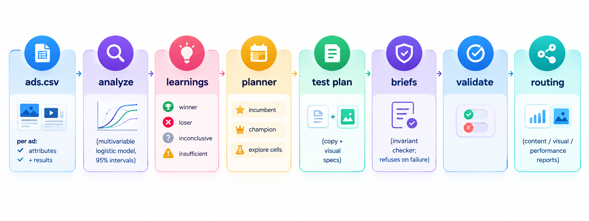

# Creative learning engine

One component of a Meta creative testing engine: it takes ad results, works out
**which creative attributes actually drive performance**, decides **what to test
next**, writes **generation briefs** for the next iteration, and **routes the
learnings to the right team**. Nothing is released unless a set of invariants holds.



## Run it

```bash
pip install -r requirements.txt
python data/generate_data.py     # 80 dummy ads with planted ground-truth effects
python run.py                    # offline: learnings, test plan, briefs, team reports -> output/
python tests/test_engine.py      # 9 tests (includes a 40-dataset robustness sweep)
```

Optional LLM copy generation (any OpenAI-compatible API):

```bash
LLM_API_KEY=... LLM_MODEL=... python run.py --llm
```

The default run is fully offline (template copy). The LLM path is tested against a
local mock server (valid reply, over-length reply, garbage reply). I have not run
it against a live provider.

Use your own data with `--data my_ads.csv` (columns: `ad_id, hook, visual, cta,
format, impressions, clicks, purchases, spend, revenue`).

## What it does, and why

**1. Separates what actually drives performance.** Averaging results per hook or
per format is misleading when creatives are produced unevenly (the best hook may
just have been shipped mostly as video). Each funnel stage is modelled with a
multivariable logistic regression (CTR: clicks/impressions, CVR: purchases/clicks)
using effect coding, so every level is compared with the average level of its
attribute. Ads vary more than chance, so the model uses a quasi-binomial
dispersion factor, which widens the intervals. The two stages combine into a net
effect on purchases per impression. Written in plain numpy so each step can be explained.

**2. Honest verdicts.** A level is a `winner` or `loser` only if its 95% interval
excludes 0 *and* it has at least 4 ads; otherwise it is `inconclusive` or
`insufficient_data`.

**3. Decides what to test next.**
- `A_incumbent`: best existing ad, the control.
- `B_champion`: the incumbent with every proven winner swapped in. This checks that
  effects stack instead of interfering, and it catches false positives.
- `C..`: the champion with exactly **one** attribute changed to an unresolved level
  (single-variable tests, so differences are attributable). A challenger is only
  tested if its best case could beat the level it replaces, and never if it would
  just recreate an existing cell.
- Budget split, minimum impressions and minimum days per cell (80% power, 5% alpha).

**4. Makes the next iteration.** Each cell becomes a structured brief (hook type,
visual concept, format, CTA, guardrails) with copy options. Humans only approve:
every generated asset is marked `needs_brand_approval`.

**5. Routes learnings.** `output/reports/` has one file per team: Content (hooks,
CTAs), Visual (concepts, formats), Performance (test plan, stopping rule).

**6. Invariant checker (`engine/validate.py`).** Before anything is written it
checks, for example: winner means the CI excludes 0; no verdict on fewer than 4
ads; budget shares sum to 1; no two cells are identical; explore cells differ from
the champion in exactly one attribute and could plausibly beat it; copy is within the length limit; every
brief is routed to brand approval. On failure the run refuses to release output
and lists every violation.

## How I know it works

The dummy data has **planted ground-truth effects** (`data/generate_data.py`), so
the tests can check the engine against the truth:
- It finds the biggest planted drivers (`gift_now` wins, `learn_more` loses).
- It never calls the wrong direction on a level with a real effect.
- In a world where nothing matters, it stays quiet (under 10% false verdicts).
- The validator catches deliberately corrupted outputs.

## Limits (deliberate, and what I would do next)

- **Expected false positives.** 15 levels at 95% gives about 0.75 false verdicts per
  run. On the default data, `format=carousel` is flagged a winner although its true
  effect is 0. That is why the champion cell exists: stacking winners is itself
  tested before anything is rolled out.
- **Purchases are too rare to test per cell.** At about 2.5% CVR and a EUR 400/day
  budget, a purchase-level test per cell would take months. Cells are decided on
  CTR (days); purchase effects come from the pooled model and are refit as new
  data arrives. The numbers are in `output/test_plan.json`.
- **Net effect assumes the two funnel stages have independent errors**, and uses
  odds ratio ~ rate ratio, which is accurate at low rates.
- **No interactions.** The model is additive (hook and visual effects add up). With
  more data I would test interactions, or move to a Bayesian hierarchical model.
- **Attributes are given.** In production a vision/LLM tagger would label every
  creative automatically (hook type, visual concept) at upload time.
- **In production**: read results from the Meta Marketing API into a warehouse,
  run this on a schedule, post the reports to Slack, and create the draft ads for
  approved briefs through the API.
